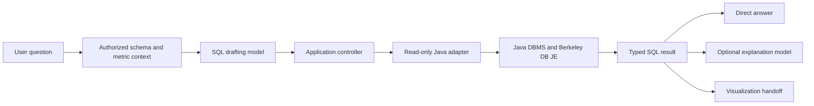

# AI SQL Engine

A Java database engine backed by Berkeley DB JE, with a Python application that
answers questions by running SQL against the engine. The model drafts a query;
the Java DBMS executes it and returns the actual result.

> **Status:** The engine implements a substantial SQLite-oriented SQL subset,
> with persistence, transactions, constraints, and query planning. It is not
> fully SQLite compatible. The read-only database adapter and question-answering
> application are implemented. Chart rendering is planned.

## What it does

| Component | Responsibility |
| --- | --- |
| Java DBMS | Parses and executes SQL, stores tables in Berkeley DB JE, and manages transactions and constraints. |
| Read-only adapter | Discovers schema, enforces a fixed table policy and query budgets, binds values, and returns typed results. |
| Python application | Selects relevant schema, asks a model to draft SQL, runs it through the adapter, and presents the result. |
| Agent skills | Define separate SQL-drafting and result-explanation instructions. The application, not a skill file, controls execution. |

The SQL engine supports common schema changes, inserts, updates, deletes,
transactions, joins, grouping, aggregates, subqueries, ordinary CTEs, indexes,
and more. See the [SQL compatibility matrix](docs/SQL_COMPATIBILITY.md) for
supported forms and known differences from SQLite.

Primary and unique keys receive automatic indexes where needed. The planner uses
key lookups, early filters, and inner-join ordering to reduce repeated scans.
See [indexing and performance](docs/PERFORMANCE.md) for existing-database upgrades,
query plans, measurements, and current limits.

### How a question is answered



The drafting model receives schema and selected metric definitions, not table
rows. The adapter checks the parsed SQL and table access before execution.
Simple results are formatted directly; an optional separate model call can
explain observed result cells. The application does not execute model-proposed
writes or render charts yet.

## Quick start

Run these commands from the repository root. You need a JDK with `java` and
`javac` on `PATH`, plus Python 3. Development has been verified with Java 21.
The required Java JARs are bundled in `dbms/lib/`; no Python packages or
dependency downloads are required for the basic setup.

### 1. Build the Java engine

```powershell
python scripts/build.py
```

### 2. Create a local database

Start the writable SQL terminal:

```powershell
java -cp ".build/classes;dbms/lib/*" DBMS ".local-db"
```

Enter the following SQL, then type `q` to close the terminal:

```sql
CREATE TABLE products (
    id INTEGER PRIMARY KEY,
    name TEXT NOT NULL,
    price REAL NOT NULL
);

INSERT INTO products (id, name, price)
VALUES (1, 'Notebook', 12.50), (2, 'Pen', 5.00);

SELECT id, name, price FROM products ORDER BY id;
```

SQL statements end with semicolons and may span lines. On macOS or Linux, use
`:` instead of `;` between the two Java classpath entries. The `.local-db`
folder is ignored by Git. Pass the **same database directory** to every
command below, and close one database terminal before opening another.

### 3. Ask questions about that database

Create `.env` if needed:

```powershell
if (-not (Test-Path .env)) { Copy-Item .env.example .env }
```

Edit `.env` and set `OPENAI_API_KEY` to your key. The file is ignored by Git.
The example model and execution limits are in
[config/agent.example.json](config/agent.example.json).

Open an interactive question session:

```powershell
python -m sql_agent ask --db ".local-db" --config config/agent.example.json
```

At `question>`, try `How many products are there?`. Ask follow-up questions in
the same session, use `.tables` or `.schema products` to inspect the database,
`.clear` to reset question context, and `.quit` or `q` to exit.

For a single question with the full structured response:

```powershell
python -m sql_agent ask --db ".local-db" --config config/agent.example.json --json "How many products are there?"
```

The normal terminal view shows the answer, executed SQL, column types, and up
to ten rows. JSON output includes all returned rows and a completeness flag.
The [SQL agent guide](docs/SQL_AGENT.md) covers model settings, table policies,
metric dictionaries, result export, and visualization handoffs.

## Other ways to run it

| Interface | Command | Use |
| --- | --- | --- |
| SQL terminal | `java -cp ".build/classes;dbms/lib/*" DBMS ".local-db"` | Create tables and run supported SQL, including writes. |
| Read-only terminal | `java -cp ".build/classes;dbms/lib/*" DatabaseClient ".local-db"` | Inspect schema and enter SELECT queries without a model. |
| One-shot SQL query | `java -cp ".build/classes;dbms/lib/*" DatabaseClient ".local-db" --query "SELECT * FROM products;" --json` | Get a structured SQL result. |
| JSON Lines tools | `python -m sql_agent tools --db ".local-db" --schema-only --allow-table products` | Give another local process controlled schema tools; omit `--schema-only` only when row access is intended. |

The database client does not create or seed a missing database. Result IDs
belong to the current client session and expire; use the agent's `--export`
option to save a full answer artifact. See the [client protocol](docs/CLIENT.md)
and [adapter guide](docs/ADAPTER.md) for limits and request formats.

## Verify the project

```powershell
python tests/run_tests.py
python tests/evaluate_agent.py
```

The full test suite builds fresh classes, uses temporary databases, checks
persistence and recovery, and compares supported SQL behavior with SQLite.
The agent evaluation uses scripted model replies and makes no paid API calls.
It tests the workflow, not live model accuracy. See
[validation](docs/VALIDATION.md) and the [roadmap](docs/ROADMAP.md).

## Project layout

| Path | Contents |
| --- | --- |
| `dbms/` | Java engine, maintained CUP/JFlex grammar, generated parser, and bundled JARs. |
| `sql_agent/` | Python database process client, model connection, context builder, and question workflow. |
| `.agents/skills/` | SQL drafting and result explanation instructions loaded by the application. |
| `config/` | Shareable model and metric dictionary examples; local overrides are ignored by Git. |
| `tests/` | Engine, adapter, client, recovery, and agent checks. |
| `docs/` | SQL compatibility, API contracts, validation, and implementation roadmap. |

The next application milestone is a visualization skill and chart renderer.
Remaining engine work toward SQLite parity includes broader query and write
syntax, more index types, and scalability improvements. Track those items in the
[roadmap](docs/ROADMAP.md).
