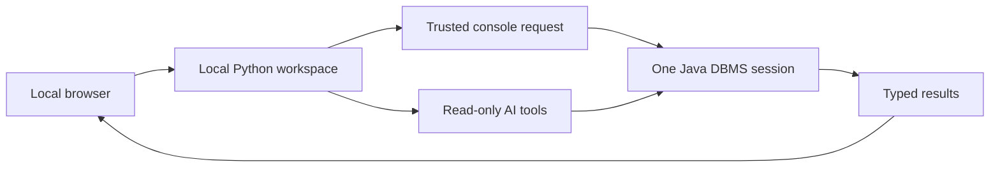

# Local browser workspace

The workspace brings the engine's SQL console, database explorer, AI questions,
results, and recent activity into one local browser interface. It uses Python's
standard library and plain HTML/CSS/JavaScript; no frontend package installation
or build step is required.

## Start the workspace

From the repository root, build the Java sources and start the UI with the same
database directory you use in the CLI:

```powershell
python scripts/build.py
python -m sql_agent ui --db ".local-db" --config config/agent.example.json --open
```

The default address is `http://127.0.0.1:8765`. Omit `--open` to open the printed
URL yourself. Use `--port 8766` to choose another port. Close an existing CLI/client
that owns the database before launching the UI. Ctrl+C closes the workspace;
unfinished transactions roll back.

The directory must contain an existing database. For a new database, open
`java -cp ".build/classes;dbms/lib/*" DBMS ".local-db"` once and exit with `q`.
The workspace can then create tables and populate data through its SQL console.
Writable workspace startup also backfills missing constraint indexes on older
databases; see [PERFORMANCE.md](PERFORMANCE.md).

SQL and browsing work without a model configuration:

```powershell
python -m sql_agent ui --db ".local-db"
```

To enable AI, configure the model with the existing JSON configuration and place
the API key in ignored `.env`. `--env-file` selects another environment file.
Existing process environment variables take precedence. Keys never enter browser
responses. Configuration is validated at startup; model calls begin only when
the user submits a question.

## Workspace sections

| Section | Available behavior |
| --- | --- |
| SQL console | One statement per run, selected SQL, positional parameters, reads/writes/schema changes, EXPLAIN QUERY PLAN, and transaction controls |
| Database explorer | Table search, columns/types/defaults, constraints, relationships, indexes, complete schema JSON, and explicit row previews |
| Ask AI | Independent conversation context per browser page, clarifications/follow-ups, answer modes, executed SQL, assumptions, usage, and result exports |
| Activity | Last 50 operations, including errors; load SQL/parameters or questions into the editor without executing them |
| Settings | Active database, model/provider readiness, dictionary, configured limits, and session behavior |

The SQL editor accepts one statement at a time. Select a statement in a larger
editor buffer, or replace the buffer, then click Run statement or press
Ctrl+Enter / Command+Enter. Semicolons are added when omitted. Parameter values
are a JSON array in the parameters panel, and become bound AST values.

SQL console statements commit automatically unless BEGIN or SAVEPOINT started a
transaction. Commit/Roll back controls show the shared transaction's state.
An engine-checked logical error preserves earlier work in that transaction;
storage/transport failures may require inspecting the database before retrying.
The application never retries writes automatically.

Database browsing and AI use the existing read-only adapter and require the host
transaction to be finished. The console can run SELECT inside a transaction.
Table selection reads metadata only; Browse 50 rows explicitly reads data and
remains subject to configured output/scan limits.

All browser tabs share one local database connection and transaction. Each page
gets a separate AI conversation; the server keeps at most eight conversation
contexts. Console writes/schema/transaction commands reset those contexts so
follow-ups cannot silently rely on stale schema or results. Existing displayed
answers remain captured snapshots. New conversation clears that page's context.

## Results and exports

Results include column names/types, actual NULLs, returned counts, completeness,
SQL/parameters, capture time, execution time, and examined-row counts. Console
responses also include affected-row counts and transaction state. The table
displays 50 returned rows per page; exports contain all returned rows. A server
preview limit is labelled Partial result and does not change a write's affected
row count. A successful empty result differs from an error.

Large INTEGER values remain exact in browser cells and downloaded JSON, including
signed 64-bit IDs. The browser preserves large integers for display and downloads
the original response text instead of serializing rounded JavaScript numbers.
The parameter editor also passes its original JSON text to Python for parsing.

JSON downloads contain the complete HTTP result envelope and provenance.
CSV exports use column headers and returned data; NULL becomes an empty CSV cell.
Formula-like strings receive an apostrophe prefix for spreadsheet use. Use JSON
to preserve original values and types exactly. Downloads are user-selected files;
the server does not create a durable result/history store.

AI responses include the existing versioned visualization handoff for later
analytics consumers. Chart rendering is not part of this UI step.

## Execution boundary



The Java client accepts console requests only with explicit `--workspace --json`
startup flags. Ordinary DatabaseClient/tool sessions still reject `execute_sql`.
Workspace mode requires unrestricted local owner access; restricted table or
schema-only configurations belong to the existing `ask`/`tools` commands.
Even in workspace mode, `query_readonly` still checks parsed statement types and
denies mutation proposals.

The HTTP server binds only to loopback, checks Host/Origin, and requires a
per-server token for POST requests. Assets are served from a fixed allowlist.
SQL, database values, and model output render as text. This is a local operator
workspace, not a remotely hosted or authenticated multi-user service.

## Verification

```text
python tests/ui_checks.py
python tests/run_tests.py
```

Checks build fresh Java classes, use temporary databases, and run against an
offline localhost model fixture. They cover writes, binding, foreign keys,
transactions, pending-work shutdown, restart persistence, partial results,
int64 values, metadata, history, conversation isolation, request protections, and
AI read-only enforcement. No paid model requests occur.

Optional rendered-browser checks use an installed Windows Chrome/Edge and Node
with built-in WebSocket support:

```text
python tests/ui_checks.py --browser
```

These exercise the actual UI and save desktop/mobile screenshots under ignored
`.build/ui-preview/`. Node and a headless browser are verification tools, not
requirements for running the application.
